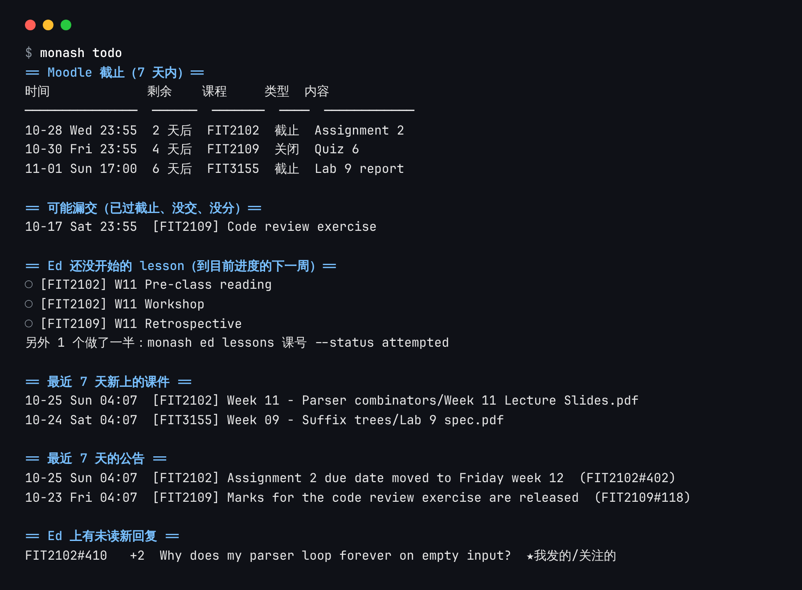
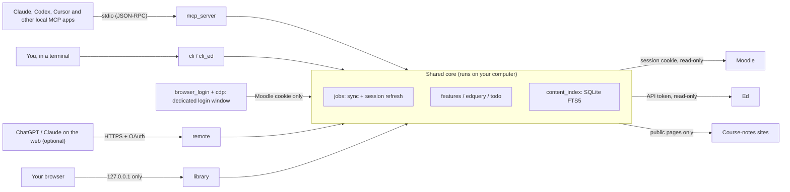

# Monash Study Kit

[](#two-parts-one-codebase)
[](#development)
[](https://github.com/Waldo0926/monash-study-kit/releases)
[](https://pypi.org/project/monash-study-kit/)
[](LICENSE)
[](#privacy-and-security)
[](https://docs.secureview.tech/study-kit/)

[](https://github.com/Waldo0926/monash-study-kit/actions/workflows/test.yml) [](https://glama.ai/mcp/servers/Waldo0926/monash-study-kit)

**English** · [中文](README.zh-CN.md)

Connect Monash **Moodle** and **Ed** to the AI app on your computer (Claude, Codex, Cursor, VS Code and others), then just ask:

- "What's due this week?": Moodle deadlines, assignments you may have missed, unfinished Ed lessons, latest announcements
- "Anything new on Ed? Has anyone replied to my question?"
- "Which week of FIT2102 covered monads? Which slide deck, which page?"
- "What does the A2 spec ask for?", "What's my current grade in FIT2109?"
- "Quiz me on FIT2109 week 3." In apps that support MCP Apps, to-dos, lesson progress and quiz questions also show up as small panels you can click

By default, everything stays **on your own computer**: course files, login state and the database live locally and never pass through a third-party server.
All tools are **read-only**: they never submit assignments, attempt quizzes or post on Ed.

Built for Monash Malaysia (times are handled as UTC+8); Australian campuses work too, see the [FAQ](#faq).



The picture is real output of `monash todo` against a database filled with made-up units, files and posts. Your AI app reads the same data through the MCP tools. Guide with more pictures: [docs.secureview.tech/study-kit](https://docs.secureview.tech/study-kit/).

---

## Two parts, one codebase

The same core (login, sync, queries) serves two kinds of "users":

**MCP: the interface for your AI app.** Moodle and Ed both sit behind Okta + MFA, so the AI cannot get in by itself.
The MCP server lets it look things up mid-conversation (tools such as `get_study_todo`, `search_content`, `list_ed_updates`):

- **Answers come from real data**: deadlines, announcements and grades are fetched live, with sources such as "Workshop 5 Slides, page 25".
- **Both platforms at once**: one "what do I need to do this week" checks Moodle deadlines, unfinished Ed lessons and announcements from both.
- **No manual copying**: no downloading PDFs and re-uploading them. The AI finds the right file and reads only the pages it needs, saving time and usage.
- **Natural follow-ups**: "What does the A2 spec require?" "Explain that week's functor material using the lecture notes."

**CLI (the `monash` command): the interface for humans.**

1. **Things only a person can do**: installation, passing MFA in the login window, pasting the Ed token (tokens should never go through a chat, so they are only entered in the terminal).
2. **No AI needed**: out of usage or just want a quick look? `monash todo` answers in a second (see [Works without AI usage](#works-without-ai-usage)).
3. **Troubleshooting and maintenance**: `status`, `sync`, `update`, `uninstall`.

In short: MCP turns your AI app into a TA who knows your units; the CLI handles setup, login and fallback. Ask in your AI app day to day, open the terminal occasionally.

## Requirements

- An AI app that supports local MCP: **Claude Desktop** ([download](https://claude.ai/download)) or **Claude Code** are set up automatically; **Codex** (including Codex in the ChatGPT desktop app), **Cursor**, **VS Code**, **Windsurf** and **Gemini CLI** take one more command (see [Other AI clients](#other-ai-clients))
- **Chrome, Edge or Brave** (the Edge that ships with Windows is fine), used to log in to Moodle
- A Monash account

## Installation

The quickest way is one command, which installs `uv`, the kit and then starts `monash setup` (you can [read the scripts](https://docs.secureview.tech/study-kit/install/) first):

```bash
# macOS, in Terminal
curl -LsSf https://docs.secureview.tech/study-kit/install.sh | sh
```

```powershell
# Windows, in PowerShell
powershell -ExecutionPolicy ByPass -c "irm https://docs.secureview.tech/study-kit/install.ps1 | iex"
```

Or do the same steps by hand:

### macOS

Open Terminal (search "Terminal" in Launchpad) and run these one at a time:

```bash
curl -LsSf https://astral.sh/uv/install.sh | sh
```

After it finishes, **close Terminal and open it again**, then:

```bash
uv tool install monash-study-kit
```

```bash
monash setup
```

### Windows

Open PowerShell (search "PowerShell" in the Start menu) and run these one at a time:

```powershell
powershell -ExecutionPolicy ByPass -c "irm https://astral.sh/uv/install.ps1 | iex"
```

After it finishes, **close PowerShell and open it again**, then:

```powershell
uv tool install monash-study-kit
```

```powershell
monash setup
```

> `uv` is a Python tool manager. It sets up Python for you, so you don't need to install Python yourself.

## First-time setup (`monash setup`)

Follow the prompts. There are four steps:

1. **Ed**: opens Ed's [API token page](https://edstem.org/au/settings/api-tokens). Click **Create Token**, name it anything,
   copy the token and paste it back into the terminal (nothing is shown while pasting; that's normal). The token doesn't expire; delete it on the same page whenever you want to revoke it.
2. **Moodle**: opens a **separate browser window**. Log in to Monash as usual (Okta + MFA). The window closes automatically once you're in.
   This window has its own profile and is completely isolated from your everyday browser: the tool only takes the Moodle session from this window
   and never reads anything from your normal browser.
3. **Units**: tracks this semester's units by default, or pick your own.
4. **Connect your AI app**: adds `monash` to Claude Desktop and Claude Code automatically.
   - On macOS it quits Claude Desktop first (Claude overwrites config edits made while it is running), then reopens it.
   - On Windows it asks you to **fully quit** Claude Desktop first: tray icon at the bottom right → right-click → Quit.
   - Using Codex, Cursor, VS Code, Windsurf or Gemini CLI? If this step says Claude Desktop is not found, ignore it. After setup, run `monash connect codex` (or `cursor`, `vscode`, `windsurf`, `gemini`) and restart that app.

At the end you can choose to sync right away. The first sync downloads all course files and takes a few minutes to around a quarter of an hour.

Then open your AI app. In Claude Desktop, **"+" → Connectors** in the chat box lists **monash**; leave it switched on. For other apps, `monash connect` shows which ones are connected.

## What's new in 1.4

- **Study panels.** In apps that support MCP Apps, "what do I need to do this week", "show my FIT2109 lesson progress" and "help me practise the week 3 quiz" also come with a small panel: deadline cards, lesson progress by module, and quiz questions you can click through. When you finish a quiz, the **交给 AI 批改** button sends your choices back to the chat and the AI explains them from the lesson. Nothing is submitted to Ed. Apps without panels still get the same text answers as before.
- **Find a Moodle activity by name.** "Where is the week 7 workshop on Moodle?" now works through the new `search_moodle_activities` tool. It needs a Moodle login.
- **Browse your files without AI.** `monash library --open` opens a page in your browser with every Moodle and Ed lesson file you have synced. Filter by unit, week or name and download the original. It only listens on `127.0.0.1`, so other devices cannot open it.
- **Optional remote access.** `monash remote serve` lets ChatGPT, or Claude on the web and phone, reach your own data over HTTPS. Use your own server and domain, or try it with a free Cloudflare quick tunnel on your own computer, which needs no account and no domain. Each app pairs with a one-time code from your terminal, and only the 16 read-only query tools are exposed. Nothing starts unless you run it. Steps are on [Host it yourself](https://docs.secureview.tech/study-kit/remote/).

1.4.1 adds `library` and `remote` to the summary at the top of `monash --help`. Everyday use on your own computer still needs no server, domain or extra account. Technical notes: [docs/panels-library-remote.md](docs/panels-library-remote.md).

## Everyday use

Just ask in your AI app. While it is open, the tool works in the background:

- syncs Ed and Moodle every hour (new posts, replies, course files) and refreshes the full-text index;
- refreshes the Moodle session every 20 minutes (Moodle logs you out after 4 idle hours).

### Not sure what to ask?

Use your own words: the AI picks tools by meaning, not keywords, so both "anything due this week" and "did I forget to submit something" reach the to-do tool.
To see everything it can do:

- Ask your AI "what can you do". In Claude you can also pick one of monash's preset prompts from the **"+" menu** (other apps show MCP prompts in their own place, or not at all): feature overview, this week's to-dos,
  Ed updates, find a topic, quiz review, assignment requirements, grades and feedback. Presets are only sent when you click them, so they cost nothing otherwise.
- Run `monash help` in the terminal: every feature with an example question and the matching command.

### When the Moodle login expires

After shutdown or a long sleep, the Moodle session expires. The AI will tell you and ask whether to log in.
If you agree, it opens the login window on your computer; if Okta still remembers you, it logs in silently without even showing the window.
You can also run it yourself:

```bash
monash login
```

While the login is expired, **deadlines still work** (they come from Moodle's calendar subscription link, which needs no login), and Ed features are unaffected.

### Works without AI usage

The CLI doesn't use AI and consumes no usage. Run `monash sync` first, then:

| I want to know | Command |
|---|---|
| What to do this week | `monash todo` |
| Deadlines | `monash due` (or `monash due FIT2102`) |
| Which file / page covers a topic | `monash grep "git rebase"` |
| New Ed posts and replies | `monash ed new` |
| Replies to my own posts | `monash ed following` |
| Read a full post | `monash ed show FIT2102#42` |
| Grades / possibly missed assignments | `monash moodle grades FIT2102` / `monash moodle assignments --missing` |

The difference is that nobody summarises for you; you get the raw information. Background sync and Moodle session refresh run while your AI app is open, because that is when the MCP server runs:
they keep running even if your usage is exhausted; if the app is closed, run `monash sync` before querying and `monash login` if Moodle has expired.

## Other AI clients

MCP is an open protocol and `monash mcp` is a standard local (stdio) MCP server, so any client that supports local MCP servers should in principle work.
`monash setup` configures Claude Desktop and Claude Code. For the others, run `monash setup` first (login and units), then one command:

```sh
monash connect            # list clients and whether monash is connected
monash connect cursor     # or codex, vscode, windsurf, gemini
```

It adds only the `monash` entry to the client's config file with the full path to the program, keeps everything else, and saves a backup first. Codex is set up with `codex mcp add` when the `codex` command exists. `--print` shows the entry without changing anything, and `--remove` takes it out again. `monash uninstall` removes it from every client.

> **Verified:** Claude Desktop and Claude Code with the local server. ChatGPT and Codex through a private remote integration on the v1.3.0 core: on 30 October 2026 Codex queried Moodle and Ed courses and ChatGPT's course query was confirmed. ChatGPT Plus works with the author's own domain and server.
>
> On 30 October 2026 the 1.4.0 package from PyPI was also checked in a clean environment with made-up data: the stdio handshake, the 18-tool catalog, the three panels, `monash library`, and the whole `monash remote` sign-in and query flow using the Claude and ChatGPT callback addresses. None of this covers the native local Codex, Cursor, VS Code, Windsurf or Gemini CLI connections. `monash connect` writes the format from each vendor's official docs (as of 2026-10); the official docs take precedence.

To configure a client by hand instead, first find the full path of the `monash` program (many clients don't inherit your terminal's PATH):

- macOS: run `which monash`, usually `/Users/<you>/.local/bin/monash`
- Windows: run `(Get-Command monash).Source` in PowerShell, usually `C:\Users\<you>\.local\bin\monash.exe`

Replace `/full/path/monash` in the examples with your path. **In JSON, Windows backslashes must be doubled**
(`C:\\Users\\...`); in TOML, use single quotes (`'C:\Users\...'`).

**Manual configuration**

| Client | Config location | Status |
|---|---|---|
| Codex CLI / Codex in the ChatGPT desktop app / Codex IDE extension | `~/.codex/config.toml` (shared by all three) | Untested |
| Cursor | `~/.cursor/mcp.json` | Untested |
| Windsurf | `~/.codeium/windsurf/mcp_config.json` | Untested |
| VS Code (Copilot) | Command Palette → `MCP: Open User Configuration` | Untested |
| Gemini CLI | `~/.gemini/settings.json` | Untested |
| ChatGPT, Claude web / mobile app | `monash remote serve` behind your own domain or a Cloudflare quick tunnel | ChatGPT Plus works with the author's domain; see [Host it yourself](https://docs.secureview.tech/study-kit/remote/) |

Codex (`~/.codex/config.toml`), or simply run `codex mcp add monash -- /full/path/monash mcp`:

```toml
[mcp_servers.monash]
command = "/full/path/monash"
args = ["mcp"]
```

Cursor (`~/.cursor/mcp.json`), Windsurf (`~/.codeium/windsurf/mcp_config.json`) and Gemini CLI (`~/.gemini/settings.json`) use the same format:

```json
{
  "mcpServers": {
    "monash": { "command": "/full/path/monash", "args": ["mcp"] }
  }
}
```

VS Code (`mcp.json`; note the outer key is `servers`, not `mcpServers`):

```json
{
  "servers": {
    "monash": { "type": "stdio", "command": "/full/path/monash", "args": ["mcp"] }
  }
}
```

If the file already lists other servers, add the `monash` entry rather than overwriting the whole file. Restart the client afterwards.

**Notes**:

- Login and unit selection are still done with `monash setup`. Without Claude installed, the last step reports "Claude Desktop not found"; just ignore it.
- Background sync and Moodle session refresh only run while the client is open and the MCP server is running.
- Tool descriptions are written with Claude in mind. Other models usually follow them fine, but this hasn't been verified.
- If you'd rather not bother, the CLI works with no AI at all (see [Works without AI usage](#works-without-ai-usage)); you can paste the output of `monash todo` and friends into any AI.

### Agent skill

For coding agents that read skills (Claude Code, Codex, Cursor and others), there is a skill that tells the agent which `monash` command answers which question, how to handle assignment questions (brief and rubric first, then staff answers on Ed, each with a source), and what it must leave to you (logins, tokens, submitting):

```sh
npx skills add Waldo0926/monash-study-kit
```

The file is [`skills/monash-study-kit/SKILL.md`](skills/monash-study-kit/SKILL.md). A test checks that every command in it still exists. `npx skills` is a third-party installer from Vercel and needs Node.js; you can also copy the file into your agent's skills folder by hand.

### What can be searched

`monash grep` and the AI's course-material search cover:

- Moodle course files (PDF, Word, PowerPoint, text and code)
- PDFs in Ed Lessons, plus content pages written directly in Ed
- **Course-notes websites**: many units publish notes on a lecturer's public site, e.g. tgdwyer.github.io for FIT2102 or
  yqtian-se.github.io for FIT2109. Pages of this kind linked from Moodle or Ed are fetched, converted to text and stored in the
  `Course notes (web)` folder of your course files. Only pages the unit links to directly are fetched (no site-wide crawling), and each page is re-fetched at most once a week.
  University websites, videos, Google Docs and similar are skipped. To turn it off: `monash config web_notes false`
- Lecture-recording transcripts (only with the `[media]` extra installed)

## Privacy and security

- **Where data lives**:
  - macOS: `~/Library/Application Support/monash-study-kit`
  - Windows: `%LOCALAPPDATA%\monash-study-kit`

  It contains course files (`files`), the database (`data`), login credentials (`secrets`, readable only by your own user account) and the dedicated login window's profile (`browser-profile`).
  Run `monash open` to open the course-files folder.
- **Stored credentials**: the Moodle session cookie, the Ed API token and the Moodle calendar subscription link. They stay on your computer and are only used to talk to Moodle / Ed.
  **Never send the `secrets` folder to anyone.**
- **What the AI can see**: only what a tool returns when you ask something (e.g. a list of deadlines, the full text of a post, the text of a course file).
  Tokens and cookies are never sent to the AI. **Don't paste your Ed token into a chat either**; it is only entered in the terminal.
- **Course library page**: `monash library` only listens on `127.0.0.1` and only serves files that sync registered. It has no password, so don't forward it to the internet.
- **Optional remote mode**: `monash remote` keeps the apps you paired in `secrets/remote-mcp.db`, storing only hashes of their tokens. Access tokens last an hour, refresh tokens 30 days and change on every use. `monash remote revoke --all` cuts every app off.
- **What it does to Moodle / Ed**: read-only. Requests are spaced out, so it never hammers university systems like a crawler.
- **Complete removal**:

  ```bash
  monash uninstall
  uv tool uninstall monash-study-kit
  ```

  `monash uninstall` removes it from Claude and the other AI clients and asks whether to delete all data. Finally, delete the token on Ed's settings page.

## Token use

Every MCP tool's name, description and parameters are sent to the model at the start of each conversation, so they cost tokens even when unused. Measured with `scripts/measure_tokens.py` on 1.4.0 (estimate: 4 ASCII characters or 1 Chinese character per token):

| Sent once per conversation | Tokens |
| --- | ---: |
| 18 tool definitions | 2,962 |
| Server instructions | 270 |
| **Total** | **3,232** |

The instructions grew from 187 in 1.2.0 when the rule for assignment questions was added (brief and rubric first, then staff answers on Ed).

The largest single tool is `search_ed_threads` at 324.

What the answers cost, measured on one student's real data (4 Moodle units, 3 Ed courses, 376 indexed files) with `--live`:

| Question | Tool answer | Pasting the files instead |
| --- | ---: | ---: |
| What's due this week (`get_study_todo`) | 3,336 | |
| Upcoming deadlines (`list_moodle_due`) | 408 | |
| New on Ed (`list_ed_updates`) | 3,934 | |
| Find "assignment" in course files (`search_content`) | 2,596 | 25,466 |
| Read the top hit, first page (`read_file`) | 96 | 96 |

"Pasting the files instead" is the full text of every file the search hit. Searching first costs about 10% of that.

To measure your own answers (what a "what's due this week" or a course-file search returns, compared with pasting the whole files), run `uv run python scripts/measure_tokens.py --live --query <word>`. It prints only numbers. With `ANTHROPIC_API_KEY` set, `--api` uses Anthropic's free token-counting endpoint for exact counts.

## Command reference

You can also query directly in the terminal without any AI:

| Command | What it does |
|---|---|
| `monash status` | Login status, last sync time |
| `monash help` | Everything it can do, each with an example question and the matching command |
| `monash doctor` | Health check when something breaks: checks each item and tells you how to fix it; send the whole output to whoever helps you |
| `monash doctor --deep` | Also fetches from Moodle and Ed and cross-checks the tools against a second source: due dates against the calendar feed, the assignment page against the course structure, synced files against Moodle, search against the files on disk, local Ed posts against Ed. Prints only counts, unit codes, dates and activity ids |
| `monash todo` | This week: deadlines, possibly missed work, unfinished Ed lessons, announcements, unread replies |
| `monash due [FIT2102]` | Deadlines |
| `monash grep "monad" [FIT2102]` | Full-text search over course files, course-notes sites, Ed lesson pages and recording transcripts (with page numbers / timestamps) |
| `monash sync` | Sync now |
| `monash login` / `monash login ed` | Log in to Moodle / replace the Ed token |
| `monash courses` | Re-pick tracked units |
| `monash open` | Open the course-files folder |
| `monash library [--open]` | Browse and download synced files in your browser (only on this computer) |
| `monash moodle grades [FIT2102]` | Grades and feedback |
| `monash moodle assignments --missing` | Possibly missed assignments |
| `monash moodle news` / `find` / `get` / `messages` / `calendar` | Announcements / find an activity / download one file / messages / calendar subscription link |
| `monash ed new` / `following` / `search` / `show FIT2102#42` | Ed updates / new replies to my posts / search / read a post |
| `monash ed lessons FIT2109` / `quiz FIT2109` | Ed lesson progress / quiz questions (for revision) |
| `monash ed read FIT2109 "W3 Pre-Class"` | A whole lesson as Markdown: text slides, reading pages and PDFs in order, plus its quiz questions |
| `monash config` | View / change settings (restart your AI app afterwards) |
| `monash connect [client]` | Connect to Codex, Cursor, VS Code, Windsurf or Gemini CLI (see [Other AI clients](#other-ai-clients)) |
| `monash remote serve` / `pair` / `clients` / `revoke` | Optional remote MCP for ChatGPT and Claude on the web ([Host it yourself](https://docs.secureview.tech/study-kit/remote/)) |
| `monash gmail todo` / `sync` / `search` / `thread` | Optional school Gmail: unread inbox mail / sync / offline search / read a thread ([setup](#optional-gmail-and-attendance)) |
| `monash attendance login` / `status` / `sync` / `overview` / `codes` | Optional attendance: log in / status / read the portal / saved classes / find check-in codes |
| `monash update` | Update to the latest version |

Add `--json` for JSON output (output is JSON automatically when piped; `--text` forces text). Every command has `--help`.

Exit codes (for scripts): 0 success, 1 bad arguments, 2 login required (`monash login` / `monash login ed`),
3 cannot reach Moodle/Ed or the server returned an error, 4 unit or post not found, 130 interrupted with Ctrl-C.

## Lecture-recording transcripts (optional)

To let your AI know what was said in class, recordings can be turned into timestamped transcripts:

- **YouTube** links in Ed "Week N … Recording" posts: YouTube captions are fetched directly, which is fast;
- **Zoom** recordings: downloaded with the passcode from the post, then transcribed on your computer with Whisper (a two-hour lecture takes 20–30 minutes on an ordinary laptop).

These dependencies are large (about 1 GB) and not installed by default. To get them, reinstall with `[media]`:

```bash
uv tool install --reinstall "monash-study-kit[media]"
```

Then run it manually when needed (it never runs in the background, so it won't slow your computer down):

```bash
monash media
```

Videos uploaded directly to Moodle aren't downloaded by default either (often hundreds of MB); they are recorded as links. To download them: `monash config download_videos true`.

## Optional: Gmail and attendance

Not on PyPI yet (see Unreleased in the [changelog](CHANGELOG.md)). Both parts are off by default and only run on your own computer.

- **School Gmail.** Keeps a private copy of your Monash mailbox. Ask "anything in my email I need to deal with?" and the AI lists recent unread school mail (promotions and social updates left out), searches it offline, reads whole threads and the text of attachments (PDF, Office, images). The default permission is read-only, so nothing in the mailbox changes, not even unread status.
- **Attendance.** Reads your classes and check-in status from the attendance portal, so you can ask "which classes this week haven't I checked in to?" or "what's the code for today's FIT2102 workshop?". Codes are looked up in synced Moodle, Ed and school mail and shown with where they came from, for you to check. Only checked against the Malaysia campus portal.

You need your own Google Cloud OAuth client for Gmail. The step-by-step guide (in Chinese) is [docs/google-and-attendance-setup.md](docs/google-and-attendance-setup.md); what is accessed and stored is in [PRIVACY.md](PRIVACY.md). In short:

```bash
uv tool install --reinstall "monash-study-kit[gmail,attendance] @ git+https://github.com/Waldo0926/monash-study-kit"
monash gmail login --client /private/path/google-client.json
monash gmail sync
monash attendance login
monash attendance sync
```

Restart your AI app after logging in. While it is open, mail syncs in the background every 30 minutes (`monash config gmail_sync_minutes`, 0 turns it off); `monash gmail sync` updates it right away. Attendance follows your timetable instead of the clock: once on weekday mornings at 8 and 15 minutes after each class you have not checked in to yet, so nothing runs at night, at weekends or between classes (`monash config attendance_auto_sync false` turns it off). You or the AI can also ask for a read any time. Each read opens one headless browser page and switches days in the portal's menu; once `monash attendance probe` shows the faster browser-free read gives the same result on your portal, `monash config attendance_fast_read true` turns that on. `monash status` and `monash doctor` show both parts once they are on, and `monash update` keeps the extras you installed.

Drafting, sending a draft, changing labels and submitting attendance stay off in the AI app until you turn them on with `monash config gmail_manage_enabled true` (after `monash gmail login --manage`) or `monash config attendance_submit_enabled true`. Even then the AI has to show you the full preview first and only runs it after you confirm that exact action. Mail is never permanently deleted.

With `monash remote serve`, each app you pair chooses on the pairing page which of these features it may use. Only features turned on on the server are offered, read-only ones start ticked and the write ones start unticked. So Claude on your phone can have attendance only and ChatGPT mail only, or neither. Apps paired earlier keep Moodle and Ed only until you pair them again, and `monash remote clients` shows what each app has.

Each part adds tool descriptions to every conversation: about 730 tokens for Gmail, 590 for attendance, and 1,900 with both plus the write switches (5,132 in total instead of 3,232). With both off nothing changes.

Not verified yet: attendance submission, how long the attendance login lasts, and portals of campuses other than Malaysia.

## Updating

```bash
monash update
```

Restart your AI app afterwards. On Windows it tells you to quit Claude first and which command to run next (a running program can't be overwritten); close Codex, Cursor or whichever app you use before updating.

You'll be told when a new version is out: an extra line after terminal commands, and a short mention when you ask your AI for your to-dos. It checks GitHub at most once a day
and sends no personal information; to turn it off: `monash config update_check false`.

## FAQ

### monash doesn't show up in your AI app

Claude Desktop or Claude Code: run `monash setup claude` to reconnect. On Windows, **fully quit** Claude from the tray first.
If it still fails, check for errors under Claude Desktop → Settings → Developer.

Codex, Cursor, VS Code, Windsurf or Gemini CLI: run `monash connect` to see whether the app is connected, then `monash connect <app>` and restart the app.

### The login window won't open / "no browser found"

Install Chrome or Edge. If your browser lives somewhere unusual, point to it:
`monash config browser "C:\Program Files\...\chrome.exe"`. If an earlier dedicated login window is still open, close it first.

### "Path too long" when syncing course files on Windows

By default Windows limits full paths to 260 characters, and unit name + week name + file name can exceed that. Store course files somewhere shorter:
`monash config files_dir C:\Monash`, then `monash sync`.

### Australian campuses

Moodle shows times in your account's time zone; the default is Malaysia (UTC+8). For Australian campuses: `monash config tz_offset 10` (11 during daylight saving).

### Where are Ed "assignment deadlines"?

Most Ed lessons have no due date; Moodle is the source of truth for deadlines. The Ed-lesson part of `get_study_todo` follows your own progress
(it lists unfinished lessons up to the week after the one you've reached).

### Something is broken

Run `monash doctor` and follow the → after each item. If you need help, send the whole output; it contains no tokens, cookies or similar.
You can also just tell your AI "monash isn't working" and it will run the same checks. The MCP background log is `mcp.log` in the data directory.

## Development

```bash
uv sync
uv run pytest
uvx ruff check src tests
uv run monash --help
```

**Releasing**: whenever `src/` changes, bump `__version__` in `src/monash_study_kit/__init__.py` (patch for bug fixes, minor for new features) and note what changed in [`CHANGELOG.md`](CHANGELOG.md). The CI `version-bump` check blocks PRs that forget it. After merging, push a tag such as `v1.1.0`: [`release.yml`](.github/workflows/release.yml) checks the tag against `__version__` and the changelog, runs the tests, builds the package, uploads it to PyPI with Trusted Publishing, installs it back from PyPI on all three OSes, and creates the GitHub release. Details are in [docs/releasing.md](docs/releasing.md).

See also [CONTRIBUTING.md](CONTRIBUTING.md), [SECURITY.md](SECURITY.md) (how to report a problem), [docs/security.md](docs/security.md) (what is protected and how it is tested) and [docs/adr](docs/adr) (design decisions).

Every PR also builds the wheel, checks what went into it (`scripts/check_dist.py`) and installs it into a clean venv to run `monash --version`, `monash help` and an MCP handshake (`scripts/smoke_test.py`), so a module left out of the package fails CI instead of failing for users.

### How it fits together



| Module | What it does |
|---|---|
| `moodlelib`, `htmldom` | Moodle client (cookie session, AJAX calls, downloads that never send the cookie off-site) and a small HTML tree for page parsing |
| `syncer` | Mirrors each unit's Moodle files into `Unit/Week NN - Title/` folders |
| `features`, `todo` | Deadlines (with an iCal fallback when the session has expired), grades, assignments, announcements, the combined to-do list |
| `edlib`, `edsync`, `edquery` | Ed API client, incremental sync of posts and replies, local queries |
| `lessons`, `lesson_reader` | Ed Lessons: progress, slides, quiz questions, a whole lesson as Markdown |
| `content_index`, `textextract`, `webnotes` | Full-text search over PDFs, Office files, course-notes websites and transcripts |
| `browser_login`, `cdp` | Dedicated login window driven over the Chrome DevTools Protocol (a minimal WebSocket client in the standard library) |
| `jobs`, `mcp_server`, `cli` | Sync and keep-alive jobs, the MCP server, the command line |
| `widgets`, `ui/panel.html` | The study panels: what each tool attaches for MCP Apps hosts, and the single HTML page that draws them |
| `library` | `monash library`: the local, read-only page for browsing synced files |
| `remote` | `monash remote`: optional single-user remote MCP with pairing codes, OAuth and PKCE |
| `doctor`, `doctor_deep`, `help_menu`, `update_check`, `claude_setup` | Health check and `--deep` cross-checks, help and preset prompts, new-version notice, adding the server to Claude |
| `recordings`, `transcribe` | Optional: lecture recordings to timestamped transcripts (`[media]` extra) |

The only runtime dependency is `pypdf`; everything else (HTTP, SQLite, WebSocket, HTML parsing) uses the standard library.
Tests run on macOS, Windows and Ubuntu with Python 3.10 and 3.13 in CI, and `ruff` checks for syntax errors, undefined names and unused imports.

## License

MIT. This is an independent student-built tool, not affiliated with Monash University, Ed or Anthropic.
