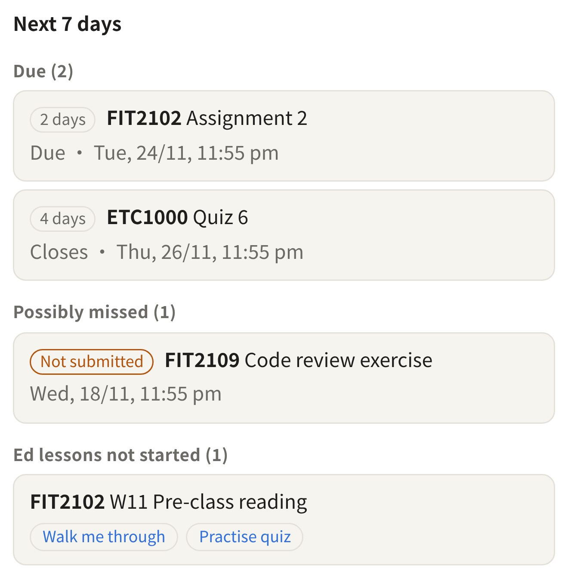
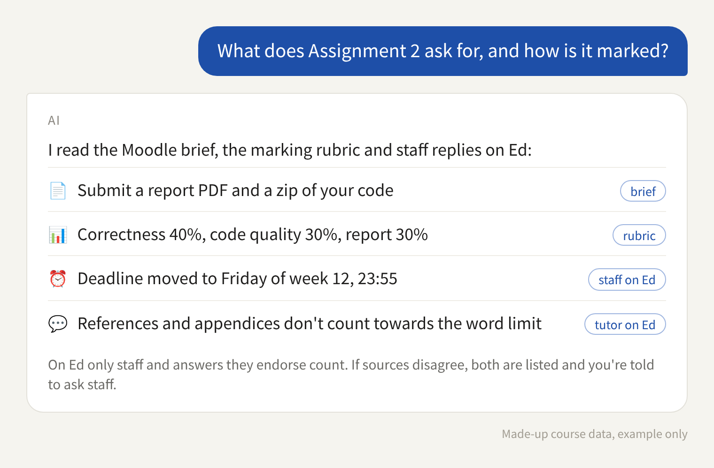
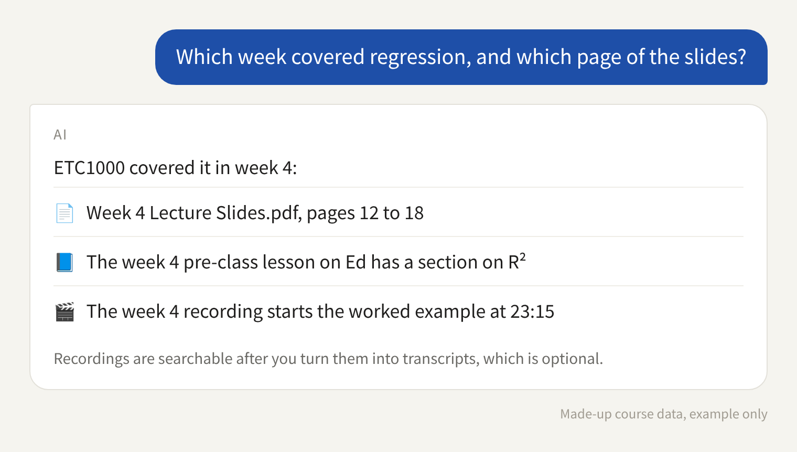
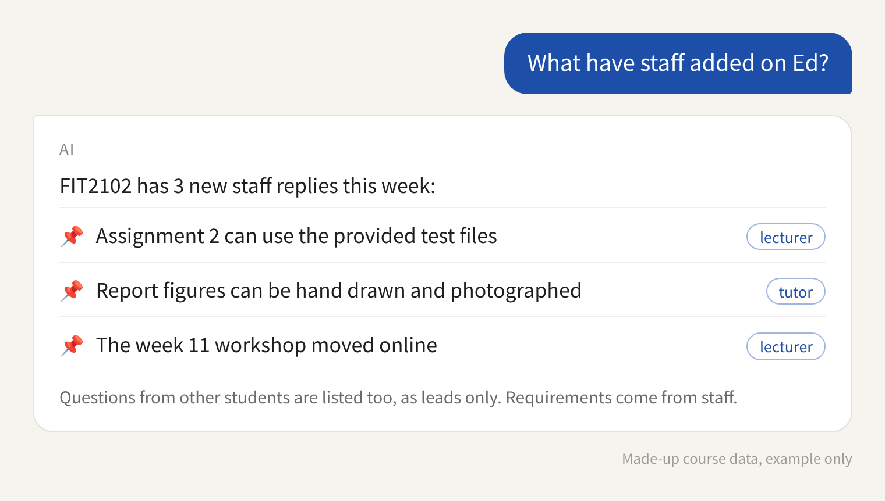
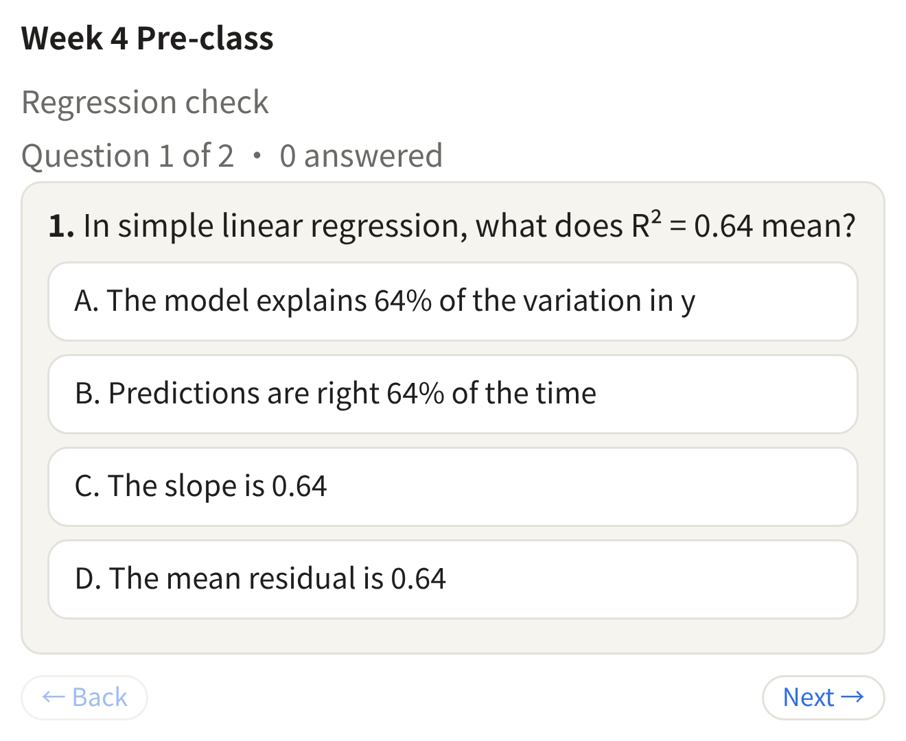
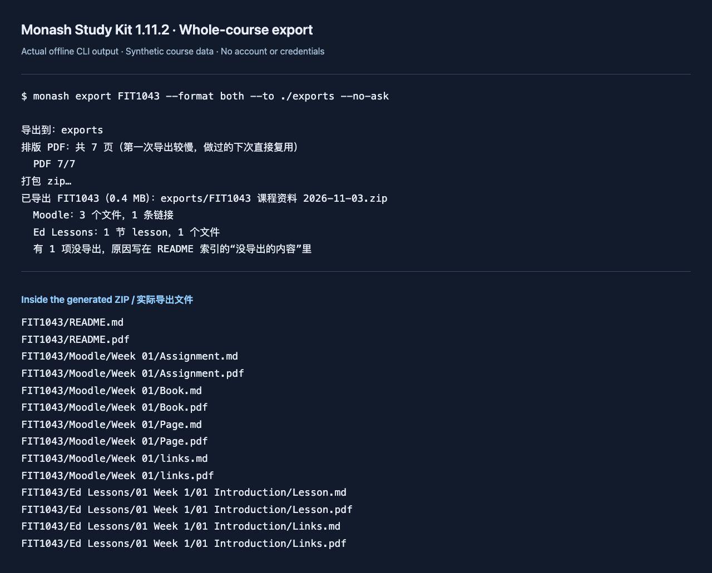
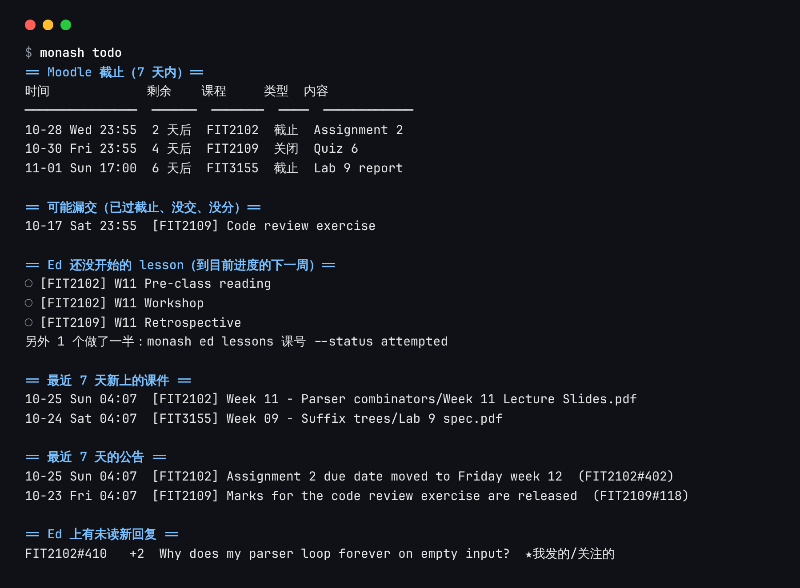
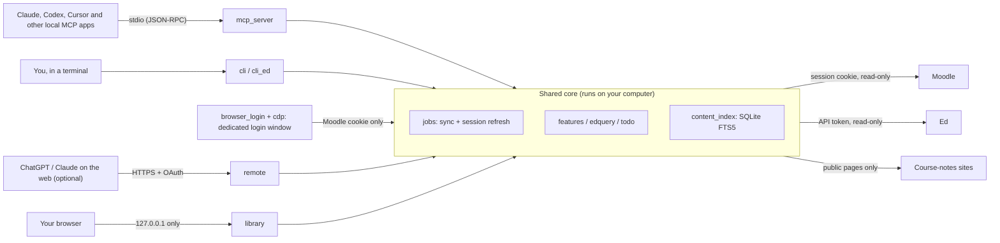

# Monash Study Kit

[](#two-parts-one-codebase)
[](#development)
[](https://github.com/Waldo0926/monash-study-kit/releases)
[](https://pypi.org/project/monash-study-kit/)
[](LICENSE)
[](#privacy-and-security)
[](https://docs.secureview.tech/study-kit/)

[](https://github.com/Waldo0926/monash-study-kit/actions/workflows/test.yml) [](https://glama.ai/mcp/servers/Waldo0926/monash-study-kit)

**English** · [中文](README.zh-CN.md)

Connect Monash **Moodle** and **Ed** to the AI app on your computer (Claude, Codex, Cursor, VS Code and others), then just ask:

- "What work and tasks do I need to finish this week?": Moodle deadlines, assignments you may have missed, unfinished Ed lessons, latest announcements
- "What have staff added on Ed? What have other students asked?"
- "Which week covered regression, and which page of the slides?"
- "What does Assignment 2 ask for, and how is it marked?", "What's my current grade in FIT2109?"
- "Quiz me on FIT2109 week 3." In apps that support MCP Apps, to-dos, lesson progress and quiz questions also show up as small panels you can click

<table>
<tr>
<td width="50%"></td>
<td width="50%"><br><br></td>
</tr>
<tr>
<td></td>
<td></td>
</tr>
</table>

<sub>Made-up course data. The panels are rendered from Study Kit's own panel code and follow your AI app's language.</sub>

You can also run **`monash semester --days 7`** for a combined private week view of Moodle deadlines, Ed lessons/replies and any locally cached attendance records. Add **`--ics`** to export a private `semester.ics` into the Study Kit data directory, or **`--ics /path/to/file.ics`** to choose a path. This is a one-time calendar snapshot, not a live subscription; deadline times must be verified with Moodle. No personal semester data is uploaded to Monash Hub.

By default, synced course files, login state and the local database stay **on your own computer**. Results returned by MCP tools go to the AI app you connect; its privacy policy applies. Optional remote access sends those results through the AI provider's connection, not through a server run by this project's maintainer.
All Moodle and Ed tools are **read-only**: they never submit assignments, attempt quizzes or post on Ed. The optional school mail and attendance parts can draft mail, change labels or check you in, and only after you confirm each action.

Built for Monash Malaysia (times are handled as UTC+8); Australian campuses work too, see the [FAQ](#faq).

The Moodle query commands in this project (overview, due, grades, alerts, forums and others) are based on [moodle-cli](https://github.com/bunizao/moodle-cli), and the optional OnTrack / Doubtfire support is based on [ontrack-cli](https://github.com/bunizao/ontrack-cli), both by [bunizao](https://github.com/bunizao). See [Acknowledgements](#acknowledgements).

**New here?** [Install](#installation) · [First-time setup](#first-time-setup-monash-setup) · [Everyday use](#everyday-use) · [FAQ](#faq)

## Requirements

- An AI app that supports local MCP: **Claude Desktop** ([download](https://claude.ai/download)) or **Claude Code** are set up automatically; **Codex** (including Codex in the ChatGPT desktop app), **Cursor**, **VS Code**, **Windsurf** and **Gemini CLI** take one more command (see [Other AI clients](#other-ai-clients))
- **Chrome, Edge or Brave** (the Edge that ships with Windows is fine), used to log in to Moodle
- A Monash account. Ed is optional: if your units don't use Ed (common in business, arts and media), Study Kit works with Moodle only
- A Windows, macOS or Linux computer

## Installation

**Quickest way: ask your AI.** If your AI app can run commands on your computer (Claude Code, Codex, Cursor, Gemini CLI), send it this:

```text
Install Monash Study Kit for me. The steps are here: https://docs.secureview.tech/agents/study-kit.md
```

It handles the install and setup. Two things you do yourself in the terminal: paste your Ed token and finish Monash MFA. It will let you know when. More details: [setting up with AI](https://docs.secureview.tech/ai-setup/).

Otherwise it is one command, which installs `uv`, the kit and then starts `monash setup` (you can [read the scripts](https://docs.secureview.tech/study-kit/install/) first):

```bash
# macOS, in Terminal
curl -LsSf https://docs.secureview.tech/study-kit/install.sh | sh
```

```powershell
# Windows, in PowerShell
powershell -ExecutionPolicy ByPass -c "irm https://docs.secureview.tech/study-kit/install.ps1 | iex"
```

Or do the same steps by hand:

### macOS

Open Terminal (search "Terminal" in Launchpad) and run these one at a time:

```bash
curl -LsSf https://astral.sh/uv/install.sh | sh
```

After it finishes, **close Terminal and open it again**, then:

```bash
uv tool install monash-study-kit
```

```bash
monash setup
```

### Windows

Open PowerShell (search "PowerShell" in the Start menu) and run these one at a time:

```powershell
powershell -ExecutionPolicy ByPass -c "irm https://astral.sh/uv/install.ps1 | iex"
```

After it finishes, **close PowerShell and open it again**, then:

```powershell
uv tool install monash-study-kit
```

```powershell
monash setup
```

> `uv` is a Python tool manager. It sets up Python for you, so you don't need to install Python yourself.

## First-time setup (`monash setup`)

Follow the prompts. There are four steps:

1. **Ed**: first it asks whether your units use Ed. Many business, arts and media units don't; answer no (or run `monash setup --no-ed`) and only Moodle is set up. You can add Ed later with `monash login ed`. If you say yes, it opens Ed's [API token page](https://edstem.org/au/settings/api-tokens). Click **Create Token**, name it anything,
   copy the token and paste it back into the terminal (nothing is shown while pasting; that's normal). The token doesn't expire; delete it on the same page whenever you want to revoke it.
2. **Moodle**: opens a **separate browser window**. Log in to Monash as usual (Okta + MFA). The window closes automatically once you're in.
   This window has its own profile and is completely isolated from your everyday browser: the tool only takes the Moodle session from this window
   and never reads anything from your normal browser.
3. **Units**: tracks this semester's units by default, or pick your own.
4. **Connect your AI app**: adds `monash` to Claude Desktop and Claude Code automatically.
   - On macOS it quits Claude Desktop first (Claude overwrites config edits made while it is running), then reopens it.
   - On Windows it asks you to **fully quit** Claude Desktop first: tray icon at the bottom right → right-click → Quit.
   - Using Codex, Cursor, VS Code, Windsurf or Gemini CLI? If this step says Claude Desktop is not found, ignore it. After setup, run `monash connect codex` (or `cursor`, `vscode`, `windsurf`, `gemini`) and restart that app.

At the end you can choose to sync right away. The first sync downloads all course files and takes a few minutes to around a quarter of an hour.

Then open your AI app. In Claude Desktop, **"+" → Connectors** in the chat box lists **monash**; leave it switched on. For other apps, `monash connect` shows which ones are connected.

## Everyday use

Just ask in your AI app. While it is open, the tool works in the background:

- syncs Ed and Moodle every hour (new posts, replies, course files) and refreshes the full-text index;
- refreshes the Moodle session every 20 minutes (Moodle logs you out after 4 idle hours).

### Not sure what to ask?

Use your own words: the AI picks tools by meaning, not keywords, so both "anything due this week" and "did I forget to submit something" reach the to-do tool.
To see everything it can do:

- Ask your AI "what can you do". In Claude you can also pick one of monash's preset prompts from the **"+" menu** (other apps show MCP prompts in their own place, or not at all): feature overview, this week's to-dos,
  Ed updates, find a topic, quiz review, assignment requirements, grades and feedback. Presets are only sent when you click them, so they cost nothing otherwise.
- Run `monash help` in the terminal: every feature with an example question and the matching command.

### When the Moodle login expires

After shutdown or a long sleep, the Moodle session expires. The AI will tell you and ask whether to log in.
If you agree, it opens the login window on your computer; if Okta still remembers you, it logs in silently without even showing the window.
You can also run it yourself:

```bash
monash login
```

While the login is expired, **deadlines still work** (they come from Moodle's calendar subscription link, which needs no login), and Ed features are unaffected.

### Choose what gets downloaded

`monash sync` downloads every file your units put on Moodle, with two exceptions:

- **Videos** uploaded to Moodle are saved as links. To download them: `monash config download_videos true`
- **Files over 300 MB**, such as a large dataset, are saved as links with their size. Change the limit with `monash config max_file_mb 100`, or set `0` for no limit

You can also leave out whole kinds of files:

```bash
monash config skip_types audio,images
```

Kinds: `pdf`, `slides`, `docs`, `sheets`, `archives`, `images`, `audio`, `code`. Set it back with `monash config skip_types ""`.

To change this for one sync only, without touching your settings:

```bash
monash sync --videos                          # this time, download videos too
monash sync --max-mb 50 --skip-types archives
```

Videos are recognised by their file name and also by the file type Moodle reports, so a recording whose address has no `.mp4` is still caught. The same rules apply to the files inside a Moodle folder. Files you already have are never deleted when you change these settings.

**See what was skipped and get it.** After `monash sync` you get a short list of the files skipped this time. Skipped files also show up as links in each week's `links.md`, and a whole-unit export lists them as not exported. To see all of them with a number:

```bash
monash skipped              # add a unit code for one unit, --videos to list videos too
```

Each file gets a number, for example `[3] Week 05/Dataset.csv (too big, 512 MB)`. Then get what you need:

- **A few files**: `monash skipped --get 3 7`. Part of the file name also works (`monash skipped --get dataset`), and `all` gets every one. These ignore the size limit and the kinds you left out
- **Many files**: raise the limit and sync again, for example `monash sync --max-mb 2000` or `monash config max_file_mb 0`. Files you already have are not downloaded again, only the skipped ones are

In your AI app you can also ask "which files weren't downloaded?" and then say which ones you want; it downloads them in the background. Before a big download it checks there is enough free disk space.

### When a sync only partly works

`monash status` says whether the last sync was complete or partial. `monash sync --retry-failed` retries only what failed. `monash changes --days 7` shows what changed in your units since you started syncing: new or replaced files, assignment instructions, deadline times and staff replies on Ed. Everything stays on your computer. When the Moodle login expires, the kit tries to sign back in quietly with its own browser profile and never opens an MFA window in the background; `monash config auto_relogin false` turns that off. If the AI app is syncing in the background, `monash sync FIT2102`, `monash export --sync` and `monash skipped --get` say so and ask you to try again when it's done, so two syncs never write the same folder. Details: [docs/reliability.md](docs/reliability.md).

### Check your work against the marking feedback

Ask your AI app something like "read what I submitted for Assignment 2 and go through the marking comments one by one". It finds the assignment with `list_moodle_assignments`, then reads its `read_path` with `read_file`: the files you or your group submitted, the online text and the full feedback you can see on Moodle. In a terminal: `monash moodle submission <cmid>`, where cmid is the activity ID from `monash moodle assignments`, not the unit ID.

- PDFs can be read page by page, and files inside a ZIP (text, code, PDF, Word, PowerPoint) can be read too
- Submissions are downloaded with your own Moodle login and kept apart in `data/submissions/`, so they never go into the course library, search or exports. Access is checked again on every read and each download is capped at 256 MiB
- Materials-only profiles can't read submissions. Videos aren't transcribed and scanned PDFs still need OCR

### Works without AI usage

The CLI doesn't use AI and consumes no usage. Run `monash sync` first, then:

| I want to know | Command |
|---|---|
| What to do this week | `monash todo` |
| Deadlines | `monash due` (or `monash due FIT2102`) |
| Which file / page covers a topic | `monash grep "git rebase"` |
| New Ed posts and replies | `monash ed new` |
| Replies to my own posts | `monash ed following` |
| Read a full post | `monash ed show FIT2102#42` |
| Grades / possibly missed assignments | `monash moodle grades FIT2102` / `monash moodle assignments --missing` |

The difference is that nobody summarises for you; you get the raw information. Background sync and Moodle session refresh run while your AI app is open, because that is when the MCP server runs:
they keep running even if your usage is exhausted; if the app is closed, run `monash sync` before querying and `monash login` if Moodle has expired.

## Two parts, one codebase

The same core (login, sync, queries) serves two kinds of "users":

**MCP: the interface for your AI app.** Moodle and Ed both sit behind Okta + MFA, so the AI cannot get in by itself.
The MCP server lets it look things up mid-conversation (tools such as `get_study_todo`, `search_content`, `list_ed_updates`):

- **Answers come from real data**: deadlines, announcements and grades are fetched live, with sources such as "Workshop 5 Slides, page 25".
- **Both platforms at once**: one "what do I need to do this week" checks Moodle deadlines, unfinished Ed lessons and announcements from both.
- **No manual copying**: no downloading PDFs and re-uploading them. The AI finds the right file and reads only the pages it needs, saving time and usage.
- **Natural follow-ups**: "What does the Assignment 2 spec require?" "Explain that week's functor material using the lecture notes."

**CLI (the `monash` command): the interface for humans.**

1. **Things only a person can do**: installation, passing MFA in the login window, pasting the Ed token (tokens should never go through a chat, so they are only entered in the terminal).
2. **No AI needed**: out of usage or just want a quick look? `monash todo` answers in a second (see [Works without AI usage](#works-without-ai-usage)).
3. **Troubleshooting and maintenance**: `status`, `sync`, `update`, `uninstall`.

In short: MCP turns your AI app into a TA who knows your units; the CLI handles setup, login and fallback. Ask in your AI app day to day, open the terminal occasionally.

## Export a whole unit's materials

Export course materials without an AI app. Install or upgrade, sign in and select your units, then run:

```bash
uv tool install --upgrade 'monash-study-kit[gmail]'
monash setup
monash google login  # only for course-linked Google files; separate read-only consent
monash export FIT1043 --sync --format both --to "./exports"
```

Replace `FIT1043` with your unit code. Packages include Moodle files, Pages, Books, assignment instructions and visible marking guides, Ed Lessons and accessible Google files; personal submissions, grades, mail and attendance are excluded. The `README` inside the package lists anything left out and why.

- **Where it goes**: in a terminal `monash export` first asks for a folder (your last choice, else Downloads). `--to <folder>` or `--no-ask` skips the question
- **PDF or Markdown**: pages, link lists, quizzes and the index come out as PDF by default, next to the original files. PDFs need Chrome, Edge or Brave; without one it falls back to Markdown and says so. `--format both` gives both, `--format md` Markdown only, and `monash config export_format both` makes that the default. Your synced Markdown stays as it is for the AI and search
- **Up to date**: `--sync` syncs this unit on Moodle and its Ed Lessons first. Without it the export only uses what is already on your computer
- **Google files** linked from Moodle or Ed Lessons: run `monash google login` once. Slides and Docs come out as PDF (`monash config google_docs_format docx` for Word), Sheets as XLSX, other Drive files as they are; Google Forms can't be exported. Google shows "this app isn't verified" the first time: choose Advanced, then continue. A school-managed account may be blocked by its admins, and then the links stay links with the reason in the index. Only files your units link to are downloaded, never the rest of your Drive. `monash sync FIT1043 --refresh-google` exports them again, `monash google logout` revokes access



This screenshot comes from a real `monash export` run against synthetic local data, deliberately including a missing attachment and an unauthorized Google link to demonstrate omissions. No real account or course content is used. Omit `--sync` to export existing local data; sync and export again to retry missing materials. See the [whole-course export guide](https://docs.secureview.tech/study-kit/materials/).



The picture is real output of `monash todo` against a database filled with made-up units, files and posts. Your AI app reads the same data through the MCP tools. Guide with more pictures: [docs.secureview.tech/study-kit](https://docs.secureview.tech/study-kit/).

---

For the original v1.1 security review and the [1.5 feature review checklist](docs/SECURITY-REVIEW-1.5-SCOPE.md), see [security documentation](docs/security.md). The earlier review does not automatically certify features added later.

## Optional: Gmail and attendance

New in 1.5.0. Both parts are off until you connect them and only run on your own computer.

- **School Gmail.** Keeps a private copy of your Monash mailbox. Ask "anything in my email I need to deal with?" and the AI lists recent unread school mail (promotions and social updates left out), searches it offline, reads whole threads and the text of attachments (PDF, Office, images). Reading never marks mail as read.
- **Attendance.** Reads your classes and check-in status from the attendance portal, so you can ask "which classes this week haven't I checked in to?" or "what's the code for today's FIT2102 workshop?". Codes are looked up in synced Moodle, Ed and school mail and shown with where they came from, for you to check. Only checked against the Malaysia campus portal.

If you only want to ask about your inbox in Claude or ChatGPT, their built-in Gmail connectors are the easiest way. The Gmail part here is for linking mail with attendance codes, searching mail and attachments offline, and using it in apps without a Gmail connector such as Codex or Cursor. No Google Cloud setup is needed: the package includes a Google app, and Google will show "this app isn't verified" (click Advanced, then continue). Using your own Google app instead is optional. The step-by-step guide (in Chinese) is [docs/google-and-attendance-setup.md](docs/google-and-attendance-setup.md); what is accessed and stored is in [PRIVACY.md](PRIVACY.md). The easiest way is to ask your AI app: "connect my school email" or "connect my attendance". It installs what is missing, opens the sign-in window on your computer, and you only sign in; nothing is typed in a terminal and no password goes into the chat. The same steps in a terminal:

```bash
uv tool install --reinstall "monash-study-kit[gmail,attendance]"
monash gmail login
monash gmail sync
monash attendance login
monash attendance sync
```

Restart your AI app after logging in. While it is open, mail syncs in the background every 30 minutes (`monash config gmail_sync_minutes`, 0 turns it off); `monash gmail sync` updates it right away. Attendance follows your timetable instead of the clock: once on weekday mornings at 8 and 15 minutes after each class you have not checked in to yet, so nothing runs at night, at weekends or between classes (`monash config attendance_auto_sync false` turns it off). You or the AI can also ask for a read any time. A read is one plain request to the portal (about 5 KB, a few seconds, no browser); if the page ever looks different from what is expected it falls back to one headless browser page. On the Malaysia portal both ways gave the same result for all 15 days the portal offers, and `monash attendance probe` repeats that check on yours. `monash status` and `monash doctor` show both parts once they are on, and `monash update` keeps the extras you installed.

Logging in turns everything on in your AI app, including drafting, sending a draft, changing labels (archive, mark as read, star) and checking in to a class. The AI has to show you the full preview first and only runs it after you confirm that exact action; a check-in is only prepared when you say you attended. Mail is never permanently deleted. To keep mail read-only, log in with `monash gmail login --read-only`; to switch an action off, `monash config gmail_manage_enabled false` or `monash config attendance_submit_enabled false`.

With `monash remote serve`, each app you pair chooses on the pairing page which of these features it may use. Only features turned on on the server are offered, read-only ones start ticked and the write ones start unticked. So Claude on your phone can have attendance only and ChatGPT mail only, or neither. Apps paired earlier keep Moodle and Ed only until you pair them again, and `monash remote clients` shows what each app has.

Each part adds tool descriptions to every conversation: with both logged in it is about 1,900 tokens more (5,132 in total instead of 3,232); without logging in nothing changes.

**If the attendance login expires**, `monash attendance maintain` checks it and, when it can, signs back in with the browser profile already on this computer. When Monash wants your password or MFA it reports `needs_login` and you run `monash attendance login` yourself. After a failed try it waits an hour before trying again. `monash attendance renew --timeout 30` tries once by hand. The kit never types your password or MFA, and it can't keep you signed in while the computer is asleep or offline. Reading codes from images needs Python 3.11 or newer.

Not verified yet: attendance submission, how long the attendance login lasts, and portals of campuses other than Malaysia.

## Optional: OnTrack / Doubtfire

New in 1.18.0. Off until you sign in, pure Python (no Node.js or extra packages required), and runs only on your own computer.

- **Unified workflow.** Reuses Study Kit's dedicated login browser profile (`browser-profile`), so if Okta already remembers you from Moodle, signing in and silent renewal work without storing your password. Refresh cookies renew short-lived access tokens over plain HTTPS (`POST /api/auth/access-token`); `--paste` also accepts a Cookie header, cURL command, access-token JSON or bare `refresh_token`.
- **What you can do.** List units, check task status/deadlines/grades (including flexible dates and special consideration days), read task sheet PDFs as Markdown via the built-in `pypdf` extractor (`monash ontrack read`), download unit/task resources, check unread tutor chat counts, and sync snapshots locally so `monash todo`, `monash semester`, `monash status` and `monash doctor` include your OnTrack tasks alongside Moodle and Ed.
- **Safety boundaries.** By default, MCP exposes only read-only OnTrack tools (`ontrack_units`, `ontrack_tasks`, `ontrack_task_sheet`, `ontrack_chats`, none of which mark comments read). Enabling optional MCP writes (`monash config ontrack_write_enabled true` or `monash ontrack login --allow-write`) adds preview-and-confirm actions (`chat_read`, `chat_send`, `task_state`) via `ontrack_prepare_action` + `execute_student_action`, and never exposes file submission in MCP. In the terminal, mutating commands (`set`, `submit`, `chat-send`, and reading a task's chat history which marks comments read on OnTrack) show a preview and require confirmation (`--confirm` / `--yes`, or `--dry-run` to inspect first). With `monash remote serve`, `ontrack.read` defaults to ticked and `ontrack.write` to unticked on the pairing page.

```bash
monash ontrack login                                     # defaults to https://ontrack.infotech.monash.edu; tick "Remember me"
monash ontrack sync                                      # cache active units/tasks for monash todo & semester
monash ontrack tasks FIT2004
monash ontrack read FIT2004 1.1P                         # task sheet PDF as Markdown
monash ontrack chats FIT2004                             # unread tutor comment counts (read-only)
```

Use `--url https://<host>` (or `monash config ontrack_url`) if you need a different OnTrack / Doubtfire site.

Not verified yet: live sign-in, task submission, and flexible-date edge cases against a real Monash OnTrack/Doubtfire deployment (tested offline against simulated OnTrack API contracts).

## Multiple accounts / course materials only

A named profile is a separate account with its own login, files, database and browser session, kept in `profiles/<name>/` inside the data folder. It's useful if you have a second Monash account, or want a copy that only holds course materials. Running `monash` without `--profile` uses your normal account as before. Profile names use lowercase letters, numbers, `-` and `_`, and `default` is taken.

```bash
monash --profile alice setup             # sign in and pick units
monash --profile alice google login      # optional, Drive read-only
monash --profile alice sync
monash --profile alice export FIT1045 --sync
monash --profile alice mcp               # local MCP with the materials tools only
monash profile list                      # run these two from your normal account
monash profile remove alice              # signs out, keeps the files
monash profile remove alice --all --yes  # also deletes files and databases
```

`MONASH_KIT_PROFILE=alice` works too; `--profile` wins if both are set.

**A named profile only handles course materials.** It syncs Moodle files, Pages, Books, assignment instructions and visible marking guides, folders, linked Google files and Ed Lessons. It doesn't sync Ed discussions, mail or attendance, and it doesn't read your deadlines, grades or submissions. It stays on this computer: `remote`, `connect`, `setup claude` and `move` are refused, and setup doesn't add it to your AI apps. It also ignores the `MONASH_KIT_DATA`, `MONASH_KIT_SECRETS`, `MONASH_KIT_FILES`, `MONASH_KIT_ED_DATA`, `MONASH_KIT_ED_TOKEN`, `ED_TOKEN` and `files_dir` overrides, so it can't end up using your normal account's folders or tokens.

Your normal account can switch to the same mode with `monash config materials_only true`. To switch back, run once with `MONASH_KIT_MATERIALS_ONLY=false` and save `false`. Data you already synced is kept.

**Removing a profile** first revokes its Google Drive and Gmail access. If revoking fails, nothing is deleted so you can try again. After that it deletes the logins (`secrets/`, `browser-profile/`, `attendance-browser/`) and keeps the downloaded files unless you add `--all`. Nothing is sent to Moodle. Ed has no way to revoke a token from here, so delete it on [Ed's API token page](https://edstem.org/au/settings/api-tokens).

<details>
<summary>Exactly which commands and tools work in materials mode</summary>

Refused commands exit with code 1.

- Allowed: `setup` (sign in and pick units), `login moodle/ed`, `google login/status/logout`, `sync`, `export`, `courses`, `status`, `doctor`, `open`, `library`, `config`, `grep`, `help`, `mcp`, `changes`, `skipped`; `ed export/lessons/read/quiz`; `moodle ls/get`; `profile list/remove` from the normal account
- `config` can't change `materials_only` while the mode is on, and a named profile can't change `files_dir`. `moodle get` only takes course files, not grade pages or submissions
- Refused: all `gmail` and `attendance` commands; `todo`, `due`, `semester`, `media`, `uninstall`, `update`, `connect`, `move`, all `remote`, `setup claude`; `ed courses/threads/search/show/new/following`; `moodle overview/due/calendar/assignments/grades/news/search/find/open/alerts/messages`. A new command is refused until it is added to the list
- MCP tools: only `list_files`, `read_file`, `search_content`, `get_ed_lessons` and `export_ed_lessons` (the last two are gone with `use_ed=false`). Other tools return an error. There is no tool to browse or search your Drive
- `doctor --deep` only checks materials and the search index

</details>

## Other AI clients

**ChatGPT:** normal ChatGPT chat (web, desktop app and phone) reaches Study Kit from OpenAI's servers, so it needs [remote mode](https://docs.secureview.tech/study-kit/remote/): an HTTPS address added as an app in developer mode, which needs a paid plan. Add it once and it works on all three. Codex inside the ChatGPT desktop app is different: it runs on your computer and shares `~/.codex/config.toml`, so `monash connect codex` is enough; type `/mcp` in a new Codex chat to check. Step by step: [Use it with ChatGPT](https://docs.secureview.tech/study-kit/chatgpt/).

MCP is an open protocol and `monash mcp` is a standard local (stdio) MCP server, so any client that supports local MCP servers should in principle work.
`monash setup` configures Claude Desktop and Claude Code. For the others, run `monash setup` first (login and units), then one command:

```sh
monash connect            # list clients and whether monash is connected
monash connect cursor     # or codex, vscode, windsurf, gemini
```

It adds only the `monash` entry to the client's config file with the full path to the program, keeps everything else, and saves a backup first. Codex is set up with `codex mcp add` when the `codex` command exists. `--print` shows the entry without changing anything, and `--remove` takes it out again. `monash uninstall` removes it from every client.

> **Verified:** Claude Desktop and Claude Code with the local server. ChatGPT and Codex through a private remote integration on the v1.3.0 core: on 30 October 2026 Codex queried Moodle and Ed courses and ChatGPT's course query was confirmed. ChatGPT Plus works with the author's own domain and server.
>
> On 30 October 2026 the 1.4.0 package from PyPI was also checked in a clean environment with made-up data: the stdio handshake, the 18-tool catalog, the three panels, `monash library`, and the whole `monash remote` sign-in and query flow using the Claude and ChatGPT callback addresses. None of this covers the native local Codex, Cursor, VS Code, Windsurf or Gemini CLI connections. `monash connect` writes the format from each vendor's official docs (as of 2026-10); the official docs take precedence.

To configure a client by hand instead, first find the full path of the `monash` program (many clients don't inherit your terminal's PATH):

- macOS: run `which monash`, usually `/Users/<you>/.local/bin/monash`
- Windows: run `(Get-Command monash).Source` in PowerShell, usually `C:\Users\<you>\.local\bin\monash.exe`

Replace `/full/path/monash` in the examples with your path. **In JSON, Windows backslashes must be doubled**
(`C:\\Users\\...`); in TOML, use single quotes (`'C:\Users\...'`).

**Manual configuration**

| Client | Config location | Status |
|---|---|---|
| Codex CLI / Codex in the ChatGPT desktop app / Codex IDE extension | `~/.codex/config.toml` (shared by all three) | Untested |
| Cursor | `~/.cursor/mcp.json` | Untested |
| Windsurf | `~/.codeium/windsurf/mcp_config.json` | Untested |
| VS Code (Copilot) | Command Palette → `MCP: Open User Configuration` | Untested |
| Gemini CLI | `~/.gemini/settings.json` | Untested |
| ChatGPT, Claude web / mobile app | `monash remote serve` with a free Cloudflare quick tunnel, a Cloudflare tunnel with a fixed address, or your own server | ChatGPT Plus works with the author's domain; see [Remote mode](https://docs.secureview.tech/study-kit/remote/) |

Codex (`~/.codex/config.toml`), or simply run `codex mcp add monash -- /full/path/monash mcp`:

```toml
[mcp_servers.monash]
command = "/full/path/monash"
args = ["mcp"]
```

Cursor (`~/.cursor/mcp.json`), Windsurf (`~/.codeium/windsurf/mcp_config.json`) and Gemini CLI (`~/.gemini/settings.json`) use the same format:

```json
{
  "mcpServers": {
    "monash": { "command": "/full/path/monash", "args": ["mcp"] }
  }
}
```

VS Code (`mcp.json`; note the outer key is `servers`, not `mcpServers`):

```json
{
  "servers": {
    "monash": { "type": "stdio", "command": "/full/path/monash", "args": ["mcp"] }
  }
}
```

If the file already lists other servers, add the `monash` entry rather than overwriting the whole file. Restart the client afterwards.

**Notes**:

- Login and unit selection are still done with `monash setup`. Without Claude installed, the last step reports "Claude Desktop not found"; just ignore it.
- Background sync and Moodle session refresh only run while the client is open and the MCP server is running.
- Tool descriptions are written with Claude in mind. Other models usually follow them fine, but this hasn't been verified.
- If you'd rather not bother, the CLI works with no AI at all (see [Works without AI usage](#works-without-ai-usage)); you can paste the output of `monash todo` and friends into any AI.

### Agent skill

For coding agents that read skills (Claude Code, Codex, Cursor and others), there is a skill that tells the agent which `monash` command answers which question, how to handle assignment questions (brief and rubric first, then staff answers on Ed, each with a source), and what it must leave to you (logins, tokens, submitting):

```sh
npx skills add Waldo0926/monash-study-kit
```

The file is [`skills/monash-study-kit/SKILL.md`](skills/monash-study-kit/SKILL.md). A test checks that every command in it still exists. `npx skills` is a third-party installer from Vercel and needs Node.js; you can also copy the file into your agent's skills folder by hand.

### What can be searched

`monash grep` and the AI's course-material search cover:

- Moodle course files (PDF, Word, PowerPoint, text and code)
- PDFs in Ed Lessons, files attached inside Ed pages, plus content pages written directly in Ed
- **Course-notes websites**: many units publish notes on a lecturer's public site, e.g. tgdwyer.github.io for FIT2102 or
  yqtian-se.github.io for FIT2109. Pages of this kind linked from Moodle or Ed are fetched, converted to text and stored in the
  `Course notes (web)` folder of your course files. Only pages the unit links to directly are fetched (no site-wide crawling), and each page is re-fetched at most once a week.
  University websites, videos, Google Docs and similar are skipped. To turn it off: `monash config web_notes false`
- Lecture-recording transcripts (only with the `[media]` extra installed)

## Privacy and security

- **Where data lives**:
  - macOS: `~/Library/Application Support/monash-study-kit`
  - Windows: `%LOCALAPPDATA%\monash-study-kit`

  That is only the default. The first `monash setup` asks where to keep the data and lists each drive with its free space; if C: has less than 5 GB free it recommends another drive. To move everything later (course files, database, logins, settings): close your AI apps, then `monash move D:\MonashStudyKit`. When the data lives elsewhere, the default folder keeps only a small `location.json` that points to it, and you do not need to log in again.

  It contains course files (`files`), the database (`data`), login credentials (`secrets`, readable only by your own user account) and the dedicated login window's profile (`browser-profile`).
  Run `monash open` to open the course-files folder, or `monash open ed` for Ed Lessons files (in `data/ed-files`, by unit code).
- **Stored credentials**: the Moodle session cookie, the Ed API token and the Moodle calendar subscription link. They stay on your computer and are only used to talk to Moodle / Ed.
  **Never send the `secrets` folder to anyone.**
- **What the AI can see**: only what a tool returns when you ask something (e.g. a list of deadlines, the full text of a post, the text of a course file).
  Tokens and cookies are never sent to the AI. **Don't paste your Ed token into a chat either**; it is only entered in the terminal.
- **Course library page**: `monash library` only listens on `127.0.0.1` and only serves files that sync registered. It has no password, so don't forward it to the internet.
- **Optional remote mode**: `monash remote` keeps the apps you paired in `secrets/remote-mcp.db`, storing only hashes of their tokens. Access tokens last an hour, refresh tokens 30 days and change on every use. `monash remote revoke --all` cuts every app off.
- **What it does to Moodle / Ed**: read-only. Requests are spaced out, so it never hammers university systems like a crawler.
- **Complete removal**:

  ```bash
  monash uninstall
  uv tool uninstall monash-study-kit
  ```

  `monash uninstall` removes it from Claude and the other AI clients and asks whether to delete all data. Finally, delete the token on Ed's settings page.

## Token use

Every MCP tool's name, description and parameters are sent to the model at the start of each conversation, so they cost tokens even when unused. Measured with `scripts/measure_tokens.py` on 1.5.0 (estimate: 4 ASCII characters or 1 Chinese character per token):

| Sent once per conversation | Tokens |
| --- | ---: |
| 19 tool definitions | 3,107 |
| Server instructions | 270 |
| **Total** | **3,377** |

1.5.0 added `start_school_service_setup` (145), which lets you connect school mail or attendance by asking your AI app. It is hidden again once both are connected; with both connected the total is 5,132. In 1.4.0 the total was 3,232.

The instructions grew from 187 in 1.2.0 when the rule for assignment questions was added (brief and rubric first, then staff answers on Ed).

The largest single tool is `search_ed_threads` at 324.

What the answers cost, measured on one student's real data (4 Moodle units, 3 Ed courses, 376 indexed files) with `--live`:

| Question | Tool answer | Pasting the files instead |
| --- | ---: | ---: |
| What's due this week (`get_study_todo`) | 3,336 | |
| Upcoming deadlines (`list_moodle_due`) | 408 | |
| New on Ed (`list_ed_updates`) | 3,934 | |
| Find "assignment" in course files (`search_content`) | 2,596 | 25,466 |
| Read the top hit, first page (`read_file`) | 96 | 96 |

"Pasting the files instead" is the full text of every file the search hit. Searching first costs about 10% of that.

To measure your own answers (what a "what's due this week" or a course-file search returns, compared with pasting the whole files), run `uv run python scripts/measure_tokens.py --live --query <word>`. It prints only numbers. With `ANTHROPIC_API_KEY` set, `--api` uses Anthropic's free token-counting endpoint for exact counts.

## Command reference

You can also query directly in the terminal without any AI:

| Command | What it does |
|---|---|
| `monash status` | Login status, last sync time |
| `monash help` | Everything it can do, each with an example question and the matching command |
| `monash doctor` | Health check when something breaks: checks each item and tells you how to fix it; send the whole output to whoever helps you |
| `monash doctor --deep` | Also fetches from Moodle and Ed and cross-checks the tools against a second source: due dates against the calendar feed, the assignment page against the course structure, synced files against Moodle, search against the files on disk, local Ed posts against Ed. Prints only counts, unit codes, dates and activity ids |
| `monash todo` | This week: deadlines, possibly missed work, unfinished Ed lessons, announcements, unread replies |
| `monash due [FIT2102]` | Deadlines |
| `monash changes [--days 7]` | What changed in your units: files, assignment instructions, deadline times, staff replies |
| `monash grep "monad" [FIT2102]` | Full-text search over course files, course-notes sites, Ed lesson pages and recording transcripts (with page numbers / timestamps) |
| `monash sync [--retry-failed]` | Sync now; `--retry-failed` retries only what failed last time |
| `monash sync --videos` / `--max-mb N` / `--skip-types a,b` | One sync with different download choices, see [Choose what gets downloaded](#choose-what-gets-downloaded) |
| `monash skipped [FIT2102] [--get 3 7\|all] [--videos]` | Files left out by the size limit, kinds or videos setting; `--get` downloads the ones you pick |
| `monash login` / `monash login ed` | Log in to Moodle / replace the Ed token |
| `monash courses` | Re-pick tracked units |
| `monash open [ed]` | Open the course-files folder (`ed`: Ed Lessons files) |
| `monash library [--open]` | Browse and download synced files in your browser (only on this computer) |
| `monash moodle grades [FIT2102]` | Grades and feedback |
| `monash moodle submission <cmid>` | What you or your group submitted for one assignment, with the full marking feedback |
| `monash moodle assignments --missing` | Possibly missed assignments |
| `monash moodle news` / `find` / `get` / `messages` / `calendar` | Announcements / find an activity / download one file / messages / calendar subscription link |
| `monash ed new` / `following` / `search` / `show FIT2102#42` | Ed updates / new replies to my posts / search / read a post |
| `monash ed lessons FIT2109` / `quiz FIT2109` | Ed lesson progress / quiz questions (for revision) |
| `monash ed read FIT2109 "W3 Pre-Class"` | A whole lesson as Markdown: text slides, reading pages and PDFs in order, plus its quiz questions |
| `monash ed export FIT2109 [--module "Week 3"] [--open]` | Zip a unit's Ed materials by week into Downloads |
| `monash export FIT1043 [--sync] [--to DIR\|--no-ask] [--format pdf\|both\|md] [--dir] [--open]` | Export a unit's course materials (Moodle + Ed Lessons) with an index of what was left out and why |
| `monash config` | View / change settings (restart your AI app afterwards) |
| `monash connect [client]` | Connect to Codex, Cursor, VS Code, Windsurf or Gemini CLI (see [Other AI clients](#other-ai-clients)) |
| `monash remote serve` / `pair` / `clients` / `revoke` | Optional remote MCP for ChatGPT and Claude on the web ([Host it yourself](https://docs.secureview.tech/study-kit/remote/)) |
| `monash gmail todo` / `sync` / `search` / `thread` | Optional school Gmail: unread inbox mail / sync / offline search / read a thread ([setup](#optional-gmail-and-attendance)) |
| `monash attendance login` / `status` / `sync` / `overview` / `codes` | Optional attendance: log in / status / read the portal / saved classes / find check-in codes |
| `monash attendance renew` / `maintain` | Try to bring back an expired attendance login with the browser profile already on this computer; stops when a password or MFA is needed |
| `monash ontrack login` / `sync` / `courses` / `tasks` / `read` / `chats` | Optional OnTrack / Doubtfire: sign in / sync local cache / units / tasks / task sheet PDF as Markdown / unread tutor chats ([setup](#optional-ontrack--doubtfire)) |
| `monash update` | Update to the latest version |

Add `--json` for JSON output (output is JSON automatically when piped; `--text` forces text). Every command has `--help`.

Exit codes (for scripts): 0 success, 1 bad arguments, 2 login required (`monash login` / `monash login ed`),
3 cannot reach Moodle/Ed or the server returned an error, 4 unit or post not found, 130 interrupted with Ctrl-C.

## Lecture-recording transcripts (optional)

To let your AI know what was said in class, recordings can be turned into timestamped transcripts:

- **YouTube** links in Ed "Week N … Recording" posts: YouTube captions are fetched directly, which is fast;
- **Zoom** recordings: downloaded with the passcode from the post, then transcribed on your computer with Whisper (a two-hour lecture takes 20–30 minutes on an ordinary laptop).

These dependencies are large (about 1 GB) and not installed by default. To get them, reinstall with `[media]`:

```bash
uv tool install --reinstall "monash-study-kit[media]"
```

Then run it manually when needed (it never runs in the background, so it won't slow your computer down):

```bash
monash media
```

Videos uploaded directly to Moodle aren't downloaded by default either (often hundreds of MB); they are recorded as links. See [Choose what gets downloaded](#choose-what-gets-downloaded).

## Updating

```bash
monash update
```

Restart your AI app afterwards. On Windows it tells you to quit Claude first and which command to run next (a running program can't be overwritten); close Codex, Cursor or whichever app you use before updating.

You'll be told when a new version is out: an extra line after terminal commands, and a short mention when you ask your AI for your to-dos. It checks GitHub at most once a day
and sends no personal information; to turn it off: `monash config update_check false`.

## FAQ

### monash doesn't show up in your AI app

Claude Desktop or Claude Code: run `monash setup claude` to reconnect. On Windows, **fully quit** Claude from the tray first.
If it still fails, check for errors under Claude Desktop → Settings → Developer.

Codex, Cursor, VS Code, Windsurf or Gemini CLI: run `monash connect` to see whether the app is connected, then `monash connect <app>` and restart the app.

### The login window won't open / "no browser found"

Install Chrome or Edge. If your browser lives somewhere unusual, point to it:
`monash config browser "C:\Program Files\...\chrome.exe"`. If an earlier dedicated login window is still open, close it first.

### "Path too long" when syncing course files on Windows

By default Windows limits full paths to 260 characters, and unit name + week name + file name can exceed that. Store course files somewhere shorter:
`monash config files_dir C:\Monash`, then `monash sync`.

### My C: drive is full

Move all of the kit's data to another drive with `monash move D:\MonashStudyKit` (close Claude and other AI apps first). The program itself is small; if you also want uv and Python off C:, set `UV_TOOL_DIR`, `UV_PYTHON_INSTALL_DIR` and `UV_CACHE_DIR` to folders on another drive before installing.

### My units don't use Ed

That's fine: deadlines, grades, course files, search, mail and attendance work without it. When `monash setup` asks for the Ed token, press Enter to skip and answer yes to "not using Ed". Or run `monash config use_ed false` at any time. After that sync, the to-do list and `monash doctor` stop mentioning Ed, and your AI app no longer lists the Ed tools. `monash login ed` turns it back on.

### Australian campuses

Moodle shows times in your account's time zone; the default is Malaysia (UTC+8). For Australian campuses: `monash config timezone Australia/Melbourne`, which also follows daylight saving. The old `monash config tz_offset 10` still works but does not change with daylight saving.

### Where are Ed "assignment deadlines"?

Most Ed lessons have no due date; Moodle is the source of truth for deadlines. The Ed-lesson part of `get_study_todo` follows your own progress
(it lists unfinished lessons up to the week after the one you've reached).

### Something is broken

Run `monash doctor` and follow the → after each item. If you need help, send the whole output; it contains no tokens, cookies or similar.
You can also just tell your AI "monash isn't working" and it will run the same checks. The MCP background log is `mcp.log` in the data directory.

### `monash: command not found`

Close the terminal and open it again; `uv` adds its tools folder to your PATH only for new windows. Still missing: run `uv tool update-shell`, then reopen the terminal.

### The first sync takes very long

The first sync downloads every file of every tracked unit. To get one unit first, run `monash sync FIT1045` (your own unit code). `monash status` shows whether the last sync was complete or partial, and `monash sync --retry-failed` retries only what failed.

### A new semester started and my new units are missing

Run `monash courses` and pick the units again, then `monash sync`.

### Ed says the token is invalid

You probably deleted the token on Ed's token page. Create a new one there and run `monash login ed` to paste it.

### I want to remove everything

`monash uninstall` removes monash from Claude and the other AI apps, then asks whether to delete all data. If you say yes it first revokes the Google authorisations (Drive and Gmail) and deletes nothing when that fails. The Ed token has no revoke API: delete it on Ed's token page. Finish with `uv tool uninstall monash-study-kit`.

## Release notes

Newest first. [CHANGELOG.md](CHANGELOG.md) has every change, and how to use each feature is in the sections above.

- **1.18**: optional pure-Python [OnTrack / Doubtfire](#optional-ontrack--doubtfire) integration (`monash ontrack`, MCP tools, and `todo`/`semester` cache)
- **1.17**: the to-do, lesson progress and quiz panels follow your AI app's language, English or Chinese
- **1.16**: [choose what gets downloaded](#choose-what-gets-downloaded) with a size limit and kinds of files to leave out, plus `monash skipped` to see and get what was left out
- **1.15**: `monash uninstall` also revokes Google access; first PyPI release since 1.11.2
- **1.14**: the [attendance login](#optional-gmail-and-attendance) comes back on its own when it can
- **1.13**: [check your work against the marking feedback](#check-your-work-against-the-marking-feedback)
- **1.12**: [partial syncs](#when-a-sync-only-partly-works), `--retry-failed` and `monash changes`
- **1.11**: Windows fixes for the login window and PDF export
- **1.9**: [fuller exports](#export-a-whole-units-materials) with Moodle Pages, Books, rubrics, Google files and PDF output
- **1.7**: `monash ed export` zips a unit's Ed materials by week; Ed files are stored by unit code
- **1.6**: `monash semester` week view and a private calendar file
- **1.5**: optional [school Gmail and attendance](#optional-gmail-and-attendance)
- **1.4**: study panels, `monash library` and [remote mode](#other-ai-clients) for ChatGPT

## Development

```bash
uv sync
uv run pytest
uvx ruff check src tests
uv run monash --help
```

**Releasing**: whenever `src/` changes, bump `__version__` in `src/monash_study_kit/__init__.py` (patch for bug fixes, minor for new features) and note what changed in [`CHANGELOG.md`](CHANGELOG.md). The CI `version-bump` check blocks PRs that forget it. After merging, push a tag such as `v1.1.0`: [`release.yml`](.github/workflows/release.yml) checks the tag against `__version__` and the changelog, runs the tests, builds the package, uploads it to PyPI with Trusted Publishing, installs it back from PyPI on all three OSes, and creates the GitHub release. Details are in [docs/releasing.md](docs/releasing.md).

See also [CONTRIBUTING.md](CONTRIBUTING.md), [SECURITY.md](SECURITY.md) (how to report a problem), [docs/security.md](docs/security.md) (what is protected and how it is tested) and [docs/adr](docs/adr) (design decisions).

Every PR also builds the wheel, checks what went into it (`scripts/check_dist.py`) and installs it into a clean venv to run `monash --version`, `monash help` and an MCP handshake (`scripts/smoke_test.py`), so a module left out of the package fails CI instead of failing for users.

### How it fits together

<details>
<summary>Diagram and module list</summary>



| Module | What it does |
|---|---|
| `moodlelib`, `htmldom` | Moodle client (cookie session, AJAX calls, downloads that never send the cookie off-site) and a small HTML tree for page parsing |
| `syncer` | Mirrors each unit's Moodle files into `Unit/Week NN - Title/` folders |
| `features`, `todo` | Deadlines (with an iCal fallback when the session has expired), grades, assignments, announcements, the combined to-do list |
| `edlib`, `edsync`, `edquery` | Ed API client, incremental sync of posts and replies, local queries |
| `lessons`, `lesson_reader` | Ed Lessons: progress, slides, quiz questions, a whole lesson as Markdown |
| `content_index`, `textextract`, `webnotes` | Full-text search over PDFs, Office files, course-notes websites and transcripts |
| `browser_login`, `cdp` | Dedicated login window driven over the Chrome DevTools Protocol (a minimal WebSocket client in the standard library) |
| `jobs`, `mcp_server`, `cli` | Sync and keep-alive jobs, the MCP server, the command line |
| `widgets`, `ui/panel.html` | The study panels: what each tool attaches for MCP Apps hosts, and the single HTML page that draws them |
| `library` | `monash library`: the local, read-only page for browsing synced files |
| `remote` | `monash remote`: optional single-user remote MCP with pairing codes, OAuth and PKCE |
| `doctor`, `doctor_deep`, `help_menu`, `update_check`, `claude_setup` | Health check and `--deep` cross-checks, help and preset prompts, new-version notice, adding the server to Claude |
| `recordings`, `transcribe` | Optional: lecture recordings to timestamped transcripts (`[media]` extra) |
| `ontrack`, `cli_ontrack` | Optional: pure-Python OnTrack / Doubtfire client, session renewal, task sheet PDF reader and local snapshot cache |

Runtime dependencies are `pypdf` and, on Windows, `tzdata`; everything else (HTTP, SQLite, WebSocket, HTML parsing) uses the standard library.
Tests run on macOS, Windows and Ubuntu with Python 3.10 and 3.13 in CI, and `ruff` checks for syntax errors, undefined names and unused imports.

</details>

## Acknowledgements

Other open source projects for Monash students that this one relates to:

| Project | What it does | How it relates | License |
|---|---|---|---|
| [bunizao/moodle-cli](https://github.com/bunizao/moodle-cli) | Moodle CLI for deadlines, grades and forums | The Moodle query commands here, and the way they work through the browser session, Moodle's AJAX API and page parsing, are based on it | MIT |
| [bunizao/edstem-cli](https://github.com/bunizao/edstem-cli) | Ed CLI and MCP server that works at any school | Similar tool. The Ed part here comes from my own earlier Ed project | MIT |
| [bunizao/ontrack-cli](https://github.com/bunizao/ontrack-cli) | OnTrack / Doubtfire CLI for units, tasks, task sheets, chats and submissions | The optional pure-Python OnTrack / Doubtfire integration here (`monash ontrack`, API client, session renewal and MCP tools) is based on it | MIT |

Thanks to bunizao for building these in the open.

## License

MIT. This is an independent student-built tool, not affiliated with Monash University, Ed, OnTrack/Doubtfire or Anthropic.
